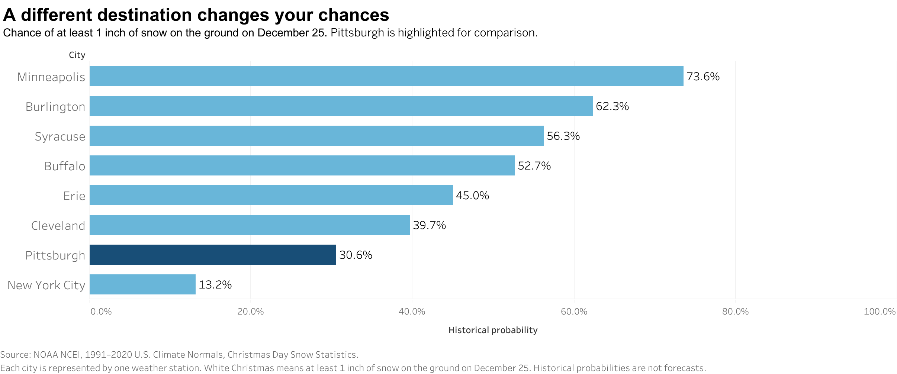
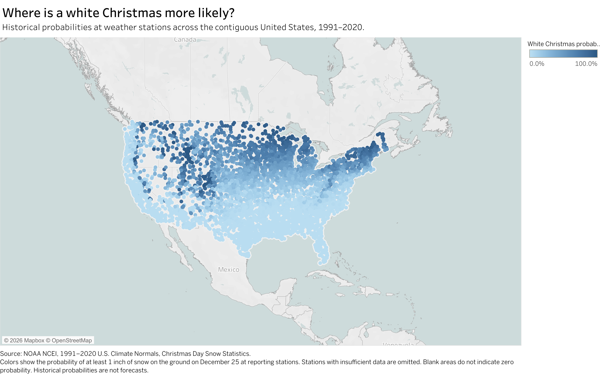
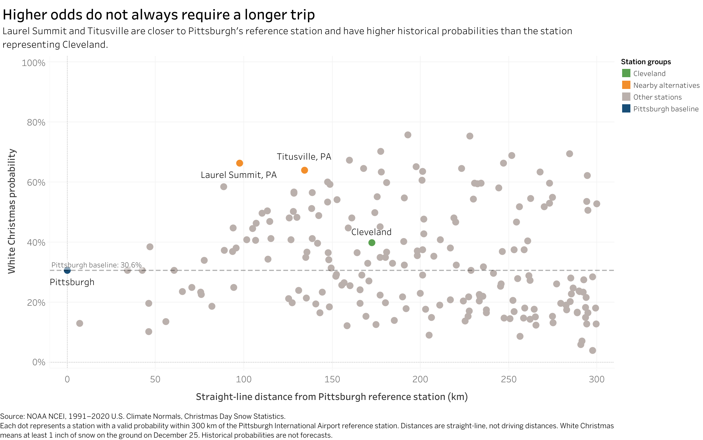

| [home page](https://wenjiajian77.github.io/tswd-portfolio/) | [data viz examples](dataviz-examples) | [critique by design](critique-by-design) | [final project I](final-project-part-one) | [final project II](final-project-part-two) | [final project III](final-project-part-three) |

# Chasing a White Christmas: A Pittsburgh Perspective

# Outline

### Project summary

A white Christmas is a familiar holiday image, but how likely is it in Pittsburgh and could choosing a different destination improve the chances? This project uses NOAA’s 1991–2020 climate normals to explore the historical probability of at least one inch of snow on the ground on December 25. It focuses on Pittsburgh-area residents and students who are interested in a snowy holiday but may not know how much probabilities vary between destinations.

The story moves from a comparison of selected cities to a broader geographic view, then returns to weather stations within 300 kilometers of Pittsburgh’s reference station. The goal is to help readers identify promising places to explore while setting realistic expectations. Higher historical probabilities do not guarantee snow in a particular year, and traveling farther does not necessarily lead to better odds. This project supports an initial destination shortlist rather than providing a weather forecast or a complete travel itinerary.

### Audience and user story

**Primary audience:** Pittsburgh-area residents and students considering a Christmas trip who have little background in climate statistics.

**User story:** As someone planning a holiday trip from Pittsburgh, I want to compare the historical chances of a white Christmas at different locations so that I can identify destinations worth investigating.

**One-sentence takeaway:** Choosing a destination can improve the historical odds of a white Christmas, and some nearby locations offer better odds than more distant alternatives.

### Scope and selection decisions

**Why these eight cities?** The bar chart uses a purposive set of recognizable destinations rather than a representative sample or a “best destinations” ranking. Pittsburgh provides the audience’s baseline. Cleveland and Erie introduce nearby alternatives; Buffalo and Syracuse extend the comparison to western and central New York; Burlington and Minneapolis provide higher-probability northern examples; and New York City provides a familiar lower-probability contrast. This selection illustrates the range of outcomes, but it cannot establish which destination is best nationwide.

**Why a national map and a local scatterplot?** The contiguous-U.S. map supplies geographic context that eight cities cannot provide. The local scatterplot then narrows the question to places closer to the audience.

**Why 300 kilometers?** I chose a 300-kilometer straight-line radius as an exploratory boundary for nearby alternatives. It includes multiple directions and locations beyond Pennsylvania while keeping the analysis centered on Pittsburgh. It is not a data-derived optimum, a driving-distance limit, or a guarantee that a destination is convenient to reach. A different radius would change the set of stations included.

### Story structure

**1. Establish the starting point: What are Pittsburgh’s chances?**

Introduce the definition of a white Christmas: at least one inch of snow on the ground on December 25, which does not necessarily mean snow falls that day. Pittsburgh’s representative station has a historical probability of 30.6%.

A horizontal bar chart compares eight selected cities, highlighting Pittsburgh as the baseline. These cities provide recognizable examples with different probabilities; they are not a comprehensive ranking of U.S. destinations.

**2. Broaden the view: Where are higher probabilities found?**

A station map of the contiguous United States reveals the geographic distribution behind the city comparisons. A sequential blue palette represents probabilities from low to high.

Readers can explore individual stations through tooltips. The map also makes clear that a single city comparison cannot capture all the variation within a region. Unmarked areas indicate gaps in the displayed station coverage, not necessarily zero probability.

**3. Return to the audience: What options are closer to Pittsburgh?**

A scatterplot compares historical probability with straight-line distance from the Pittsburgh International Airport reference station, including valid stations within 300 kilometers.

Four highlighted locations give the comparison a clear purpose:

- **Pittsburgh:** the starting point and probability baseline.
- **Cleveland:** a recognizable major-city comparison with a probability of 39.7%.
- **Laurel Summit:** a nearby mountain-area station with a probability of approximately 66%, about 98 kilometers from the reference station.
- **Titusville:** a station representing a smaller-city alternative, with a probability of approximately 64%, about 135 kilometers away.

The Laurel Summit and Titusville stations are closer to the reference station than the Cleveland station and have higher historical probabilities.

**4. Close with a practical takeaway**

Encourage readers to consider specific locations rather than assuming that a longer trip guarantees better chances. Historical probabilities can inform an initial shortlist, while actual travel decisions also require weather forecasts, transportation information, and local conditions.

## Initial sketches

The following Tableau prototypes serve as my initial visual designs. They show the planned sequence, chart types, annotations, and key messages. I will refine their presentation and interaction based on audience feedback.

### Prototype 1: A different destination changes your chances

The comparison shows that familiar destinations offer substantially different historical odds: Pittsburgh’s representative station is at 30.6%, compared with 73.6% for Minneapolis and 13.2% for New York City. The Minneapolis–Pittsburgh difference is 43.0 percentage points. This establishes that destination choice matters before the story turns to geographic patterns and nearby options.

I chose horizontal bars because the main task is to compare eight named locations precisely.Pittsburgh uses dark blue while the other cities use light blue, keeping the audience’s starting point visible. 

A map would show the locations more effectively but would make small probability differences harder to compare. I therefore reserve the map for the next question.

### Prototype 2: Where is a white Christmas more likely?

The map reveals a pattern that the city chart alone cannot show: higher probabilities appear across many northern stations and parts of the mountainous West, while many southern stations have low probabilities. This suggests that readers should examine specific locations rather than treating all places within a broad region as equivalent.

Each equal-sized circle represents one weather station at its recorded coordinates. A sequential light-to-dark blue scale encodes probability from 0% to 100%; darker blue means a higher probability. I chose a sequential scale because probability has a natural low-to-high order and no meaningful midpoint requiring a diverging palette.

I use station symbols rather than filled states because the data describe individual stations, not statewide averages. I reduced the point size after the initial version produced excessive overlap and removed persistent station labels to preserve the national pattern; readers can retrieve names and values through tooltips. Blank areas are explicitly identified as gaps in displayed coverage rather than zero probability.

### Prototype 3: Higher odds do not always require a longer trip

This chart challenges the assumption that traveling farther necessarily improves the chance of a white Christmas. Laurel Summit is approximately 98 kilometers from the Pittsburgh reference station, with a historical probability of about 66%. The Titusville station is approximately 135 kilometers away, with a probability of about 64%. Both are closer than the Cleveland station and have higher probabilities than Cleveland’s 39.7%.

The scatterplot places straight-line distance on the horizontal axis and historical probability on the vertical axis. Unlike a sorted bar chart, it lets readers compare both considerations simultaneously. A dashed horizontal line at 30.6% identifies stations above or below Pittsburgh’s baseline. All valid stations within the selected radius remain visible as muted gray points, so the highlighted examples do not replace the broader distribution.

The four highlighted locations have distinct roles: Pittsburgh is the baseline, Cleveland is a recognizable major-city comparison, Laurel Summit is a nearby mountain-area example, and Titusville is a smaller-city example. Orange links Laurel Summit and Titusville as the two alternatives central to the comparison, while Pittsburgh and Cleveland have separate colors and direct labels.

### Design development and alternatives

The main design challenge was making each visualization answer a different question. My initial set included a city bar chart, a map of the same eight cities, and a stacked chart showing the probability of a white Christmas alongside its complement. Although the formats differed, they largely repeated the same information. I expanded the map to the contiguous United States and replaced the complementary-probability chart with a distance comparison.

I also explored elevation-versus-probability scatterplots for Colorado and Pennsylvania. Colorado offered a visually clear relationship, but it shifted the story away from the Pittsburgh audience. Pennsylvania was more locally relevant, yet elevation still answered a geographic question more directly than a travel-planning question. I ultimately selected distance because it connects the third visualization to the audience’s decision while adding information absent from the first two charts.

# The data

The primary source is NOAA’s National Centers for Environmental Information (NCEI), specifically the **Christmas Day Snow Statistics** spreadsheet based on the **1991–2020 U.S. Climate Normals**. I have downloaded the original workbook and prepared a working Excel file for Tableau. The source includes station identifiers, station names, states, latitude, longitude, elevation, and the probability of snow depth reaching at least one inch on December 25.

Data preparation included removing introductory rows from the analytical tables, standardizing field names, converting probabilities to a 0–1 scale for Tableau percentage formatting, and treating the source’s `-9999` insufficient-data code as missing rather than zero. Separate tables support the selected-city comparison and the broader station analysis. Station identifiers preserve the connection between displayed locations and their underlying observations.

For the distance scatterplot, I calculated straight-line distances using station coordinates and Tableau’s spatial functions. The origin is the Pittsburgh International Airport reference station, rather than Pittsburgh’s city center. The 300-kilometer radius defines the scope of this local comparison; it does not represent a driving-distance limit or a day-trip travel time.

### Interpretation and limitations

- Probabilities describe historical climate conditions, not forecasts for an upcoming Christmas.
- Snow already on the ground qualifies; fresh snowfall on December 25 is not required.
- City values come from individual representative stations, not citywide averages.
- Stations are unevenly distributed, so the map does not provide complete spatial coverage.
- Straight-line distance does not account for roads, travel time, transportation availability, or cost.
- These data do not establish why one station has a higher probability than another.

### Data access

| Name | URL | Description |
|------|-----|-------------|
| Christmas Day Snow Statistics spreadsheet | [NOAA downloadable dataset](https://www.ncei.noaa.gov/media/3501) | Public download page for the original station-level Excel workbook used in this project. |
| U.S. Climate Normals | [NOAA dataset documentation](https://www.ncei.noaa.gov/products/land-based-station/us-climate-normals) | Background on the climate normals underlying the probability estimates. |
| White Christmas overview | [NOAA explanatory article](https://www.ncei.noaa.gov/news/white-christmas) | Explanation of the white Christmas definition, map, and interpretation of historical probabilities. |

# Method and medium

I am using Tableau to build the three interactive visualizations and Tableau Public to host them. I will use consistent typography, percentage formatting, and a recurring Pittsburgh highlight across the charts. Sources and interpretation notes will accompany each visualization. For audience testing, I plan to ask Pittsburgh-area readers to complete three tasks: identify how Pittsburgh compares with a selected city, explain what a dark-blue map point represents, and find a highlighted location that is closer than Cleveland but has a higher historical probability. Their answers will help me assess whether the labels, captions, and story sequence communicate the intended message without additional explanation.

## References

- NOAA National Centers for Environmental Information. *Christmas Day Snow Statistics, 1991–2020*. [Dataset download page](https://www.ncei.noaa.gov/media/3501).
- NOAA National Centers for Environmental Information. *U.S. Climate Normals*. [Dataset documentation](https://www.ncei.noaa.gov/products/land-based-station/us-climate-normals).
- NOAA National Centers for Environmental Information. *Are You Dreaming of a White Christmas?* [Article](https://www.ncei.noaa.gov/news/white-christmas).

## AI acknowledgements

I used ChatGPT to  draft the text for this page.
